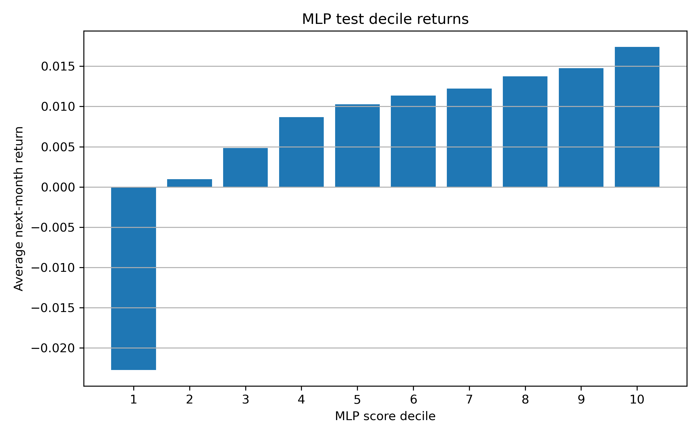

# Cross-sectional ML equity strategy

A machine-learning long-short strategy for US stocks. Every month, a neural network and gradient-boosted
trees rank all US common stocks by their expected return next month relative to the other stocks. A
market-neutral book then buys the top-ranked stocks and shorts the bottom-ranked ones, and the backtest
charges realistic trading and borrowing costs.

- **Data:** CRSP, Compustat, IBES, short interest and 13F holdings from WRDS, 1980–2025: about 4.9M CRSP
  stock-month rows and about 200 candidate inputs.
- **Models:** a PyTorch MLP with an industry embedding, LightGBM, and their ensemble. They are refitted
  every year on all the history available at the time (walk-forward).
- **Backtest:** trades one day after the signal, uses a per-stock cost model with spreads and market
  impact, sets borrow-fee tiers from short interest and institutional ownership, and targets 10%
  volatility. Returns are also regressed on the Fama-French five factors, momentum and short-term
  reversal to measure alpha.

> The full write-up (data handling, all 199 inputs, timing rules, cost model, decision rules,
> limitations) is in **[docs/METHODOLOGY.md](docs/METHODOLOGY.md)**.

## Results

**Signal quality** (network fitted once on 1980–2004; Spearman rank IC averaged over months):

| | Validation 2005–14 | Test 2015–24 |
| --- | --- | --- |
| Mean monthly IC | 0.111 (t = 22.6) | 0.121 (t = 12.8) |



**Traded book after all costs** ($100M fund, trading one day after the month-end close, cost-aware
rebalancing):

| | Validation 2005–14 | Test 2015–24 |
| --- | --- | --- |
| Gross return / year | 24.0% | 13.7% |
| Total cost / year (trading + borrow) | 6.8% | 4.8% |
| **Net return / year** | **17.2%** | **8.9%** |
| Net Sharpe | 2.01 | 0.97 |
| Max drawdown | −7.0% | −27.4% |
| Alpha / year after FF5 + momentum + reversal | 15.9% (t = 5.1) | 7.1% (t = 2.6) |

All settings were chosen on the validation period, and the test period was used only for evaluation.
The drop from validation to test is the main open problem, and it is what v5's walk-forward retraining
targets ([methodology, section 7](docs/METHODOLOGY.md#7-results)).

## What makes it realistic

- **No look-ahead.** Accounting data are used only after their SEC filing date, the book trades one day
  after the inputs are measured, and inputs are selected on the training years only.
- **Costs per stock.** Commission, half-spread and square-root market impact, scaled by each stock's liquidity and
  volatility. At these costs, trading takes a third or more of the gross return.
- **Shorting constraints.** Stocks with less than 5% institutional ownership cannot be shorted, and
  borrow fees come in three tiers.
- **Factor-adjusted.** Alpha is measured after the standard academic factors, with Newey-West
  t-statistics.

## Repository layout

```
src/
  data/            WRDS download scripts (CRSP, Compustat, IBES, 13F, short interest, FRED)
  preprocessing/   point-in-time panel, feature engineering, cost-model inputs, data checks
  models/          MLP (PyTorch), walk-forward ensemble with LightGBM, permutation importance
  evaluation/      backtest engine, portfolio construction, cost model, cost study, factor alpha
results/           metrics, IC tables, backtest grids, figures, trained checkpoint
data/processed/    small reports describing the processed panel (no raw data)
docs/              full methodology
```

## Running it

The raw data are licensed from WRDS and are **not included**, so reproducing the results needs a WRDS
account.

```bash
pip install -r requirements.txt
python src/data/download_wrds.py --username YOUR_WRDS_USERNAME
python src/preprocessing/build_processed_data.py
python src/models/walk_forward.py
python src/evaluation/cost_study.py --run wf_full
```

The full sequence of commands is in the
[methodology appendix](docs/METHODOLOGY.md#appendix-code-layout-and-how-to-run-it).

## Tech

Python, PyTorch, LightGBM, pandas, NumPy, scikit-learn, matplotlib, WRDS (PostgreSQL).
